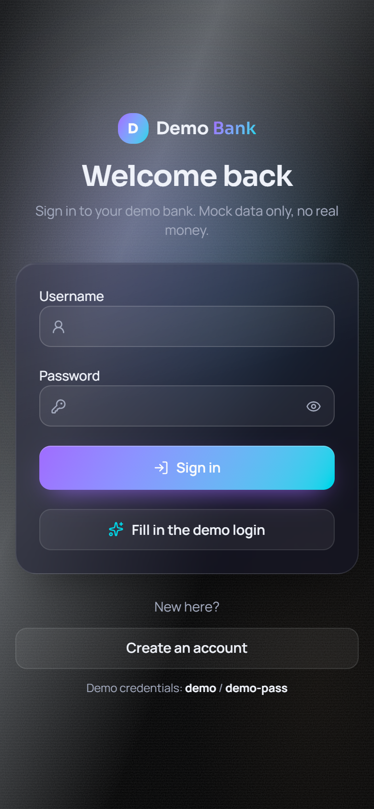
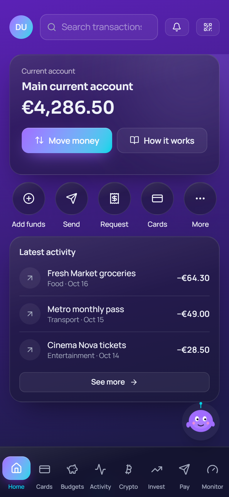
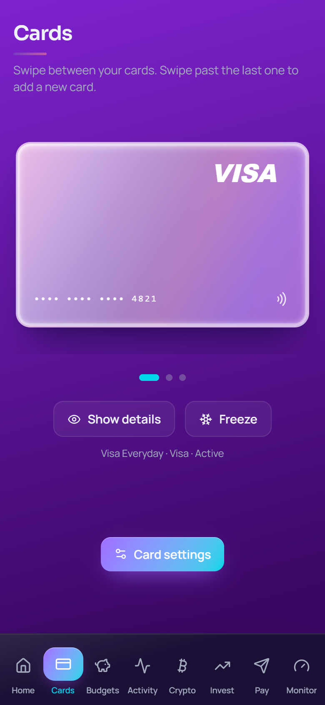
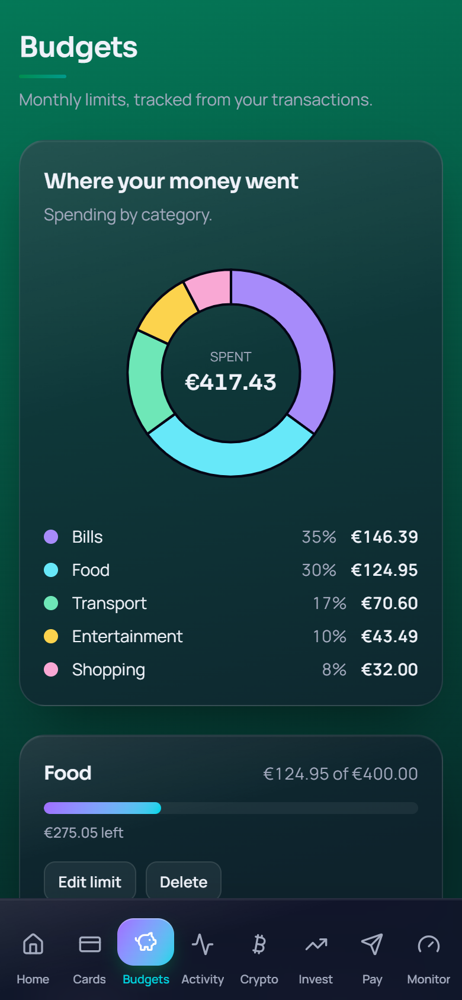
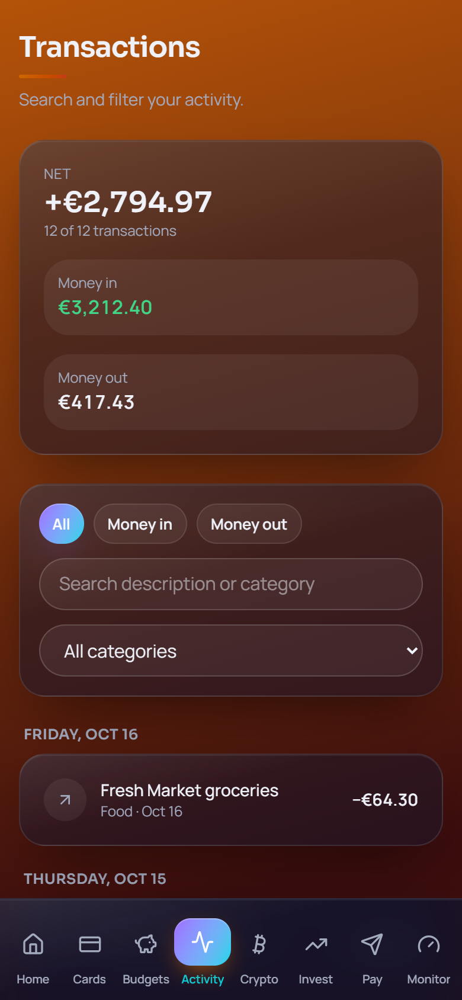
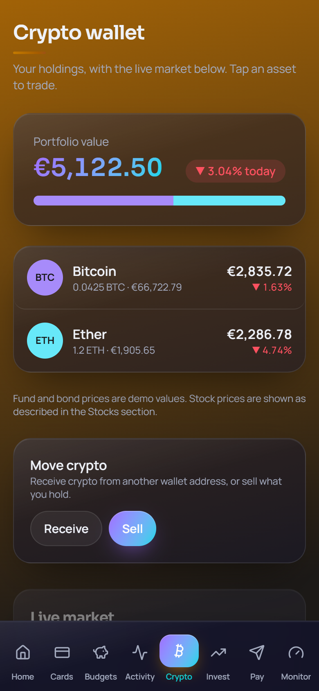
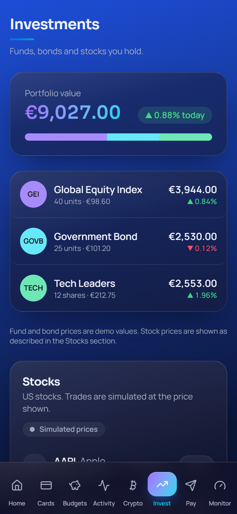
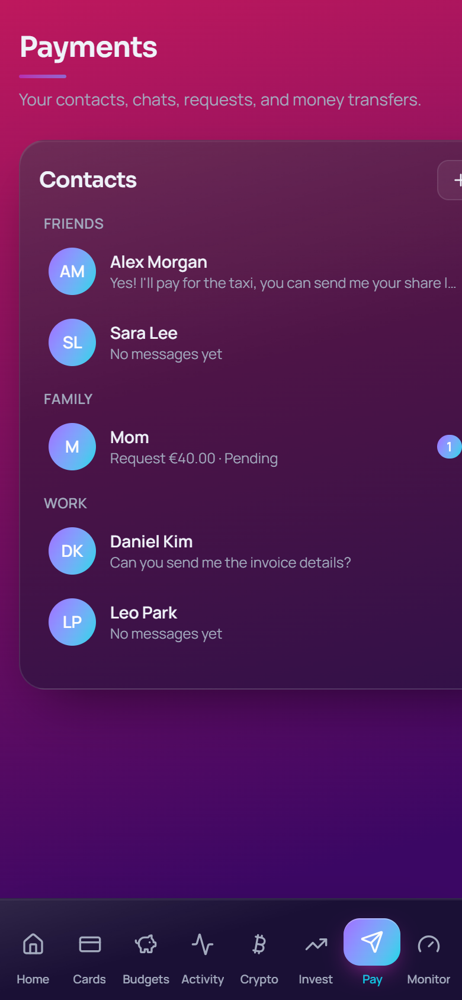
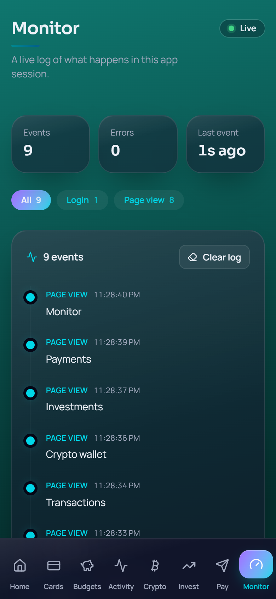

# Demo Bank

A phone-first demo retail banking app built with React, TypeScript, Vite, and Tailwind.

**Mock data only.** No real money, cards, or accounts are involved.

## Screenshots

<table>
  <tr>
    <td align="center"><br />Sign in</td>
    <td align="center"><br />Overview</td>
    <td align="center"><br />Cards</td>
  </tr>
  <tr>
    <td align="center"><br />Budgets</td>
    <td align="center"><br />Activity</td>
    <td align="center"><br />Crypto wallet</td>
  </tr>
  <tr>
    <td align="center"><br />Investments</td>
    <td align="center"><br />Payments</td>
    <td align="center"><br />Monitor</td>
  </tr>
</table>

## Features

**Accounts and money**
- Main current account, plus extra accounts (savings, currency and others) with plan limits: Everyday allows 2 accounts, Plus 5, Pro and Private no limit.
- Add funds, send money, request money, and move money between your accounts.
- Round-ups and transaction details; the Activity page totals leave out transfers.
- Profile → Settings → Display → Currency: show every amount in EUR, USD, GBP or CHF. Rates come live from the European Central Bank (Frankfurter) and refresh hourly. If you are offline, built-in fallback rates are used.

**Cards**
- Order a card with a step-by-step wizard: choose the type (debit, credit, prepaid, online only), the network, the metal finish, and digital or physical delivery.
- Set a monthly limit, choose whether online payments are allowed, and freeze a card.

**Budgets and planning**
- Budgets with spending by category and a donut chart.

**Crypto and investments**
- Crypto wallet with holdings, portfolio value, a live market table (Binance prices), receive and sell.
- Investments and stock market with price charts. Trading is simulated. Stock quotes are simulated unless you add a Finnhub API key.

**Assistant and feel**
- Pip, a built-in assistant that answers questions about the app.
- A guided welcome tour for new accounts, which you can replay from Profile → Help.
- Five colour themes (Profile → Theme, also in Settings), sounds you can switch off, and light haptic feedback on phones that support it.
- Auto-lock after 1, 5 or 15 minutes of inactivity (Profile → Security and privacy).

**Monitor**
- A live log of sign-ins, page views, and errors in the current session.

**Phone app**
- A Capacitor project for Android is included in `android/`. Run `npm run build:phone` to build the web files it uses.

## Demo login

- Username: `demo`
- Password: `demo-pass`

## What you need

- **Node.js 20 or newer** (tested with Node 24). Download it from https://nodejs.org (the LTS version is fine).
- **Git** (to clone the project). Download it from https://git-scm.com.
- A web browser (Chrome, Edge, or Firefox).

To check that Node is installed, open a terminal and run:

```bash
node -v
npm -v
```

## Open the project on a new PC

### 1. Clone the repository

The repo is private, so you need to be signed in to GitHub on this PC. The easiest way is the GitHub CLI:

```bash
gh auth login
```

Then clone it:

```bash
git clone https://github.com/Seddik-gif/demo-bank-lovable.git
```

Or, without the GitHub CLI, run the `git clone` command above and sign in when git asks.

### 2. Go into the project folder

```bash
cd demo-bank-lovable
```

### 3. Install the dependencies

This downloads everything listed in `package.json` into a `node_modules` folder. It only needs to run once (or after dependencies change).

```bash
npm install
```

### 4. Start the app

```bash
npm run dev
```

The terminal prints an address, usually `http://localhost:5173`. Open it in your browser.

- The full app is at `/`.
- The phone-sized preview is at `/phone`. This is the easiest way to see the app as a phone would show it.

Press `Ctrl+C` in the terminal to stop the server.

## Other commands

| Command | What it does |
| --- | --- |
| `npm run dev` | Starts the app for development, with live reload |
| `npm run build` | Builds the production version into `.output` |
| `npm run build:phone` | Builds the single-page version used by the phone app |
| `npm test` | Runs the automated tests |
| `npx tsc -p tsconfig.json --noEmit` | Checks the TypeScript types without building |

## Good to know

- **Your data is saved in the browser**, under local storage, not in the project. Data on one PC or browser won't appear on another. Settings → *Reset demo data* restores the defaults.
- **Generated folders are not in git.** `node_modules`, `.output`, `.wrangler`, and `.tanstack` are created on your PC, and `.gitignore` keeps them out of the repo.
- **Sounds** are generated by the browser (Web Audio). Turn them on or off in Settings.

## Troubleshooting

- **`npm` is not recognized:** Node.js isn't installed or the terminal was opened before installing it. Install Node.js, then open a new terminal.
- **`git clone` asks for a password:** GitHub no longer accepts account passwords. Sign in with `gh auth login`, or use a personal access token.
- **The port is already in use:** Start on another port with `npm run dev -- --port 5180`.
- **The page looks stale after a change:** Refresh the browser, or clear the site data for `localhost` in the browser settings.
